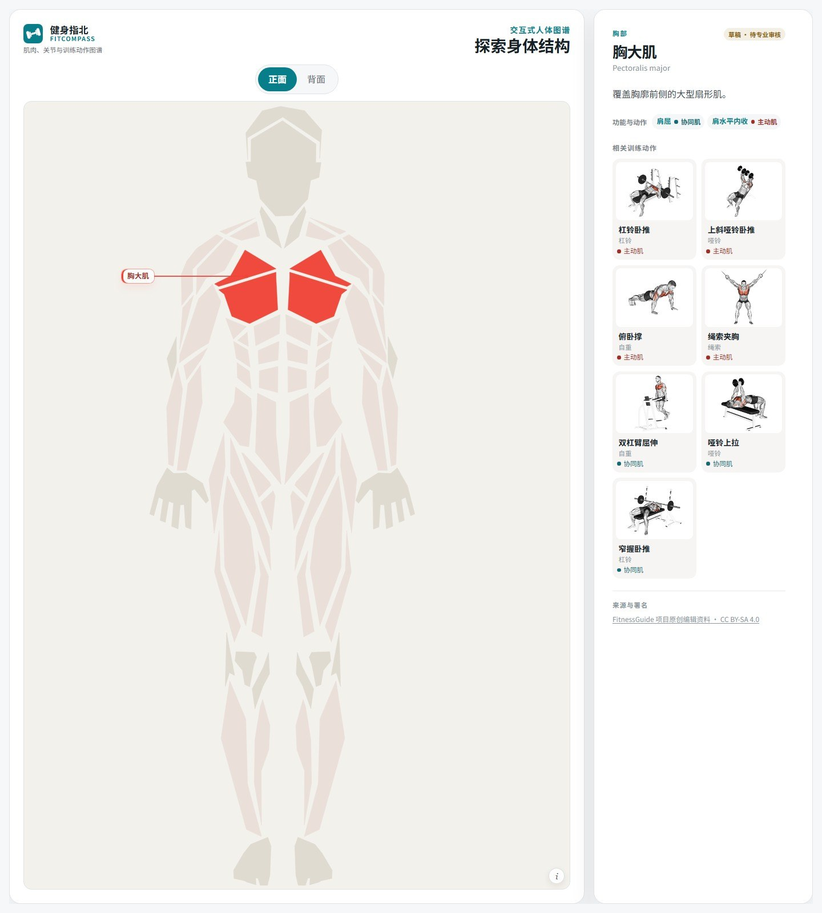
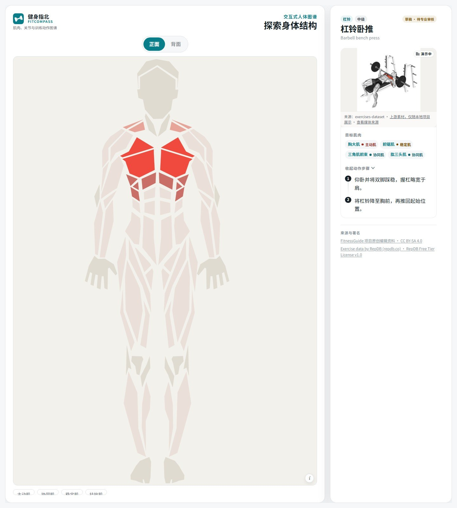
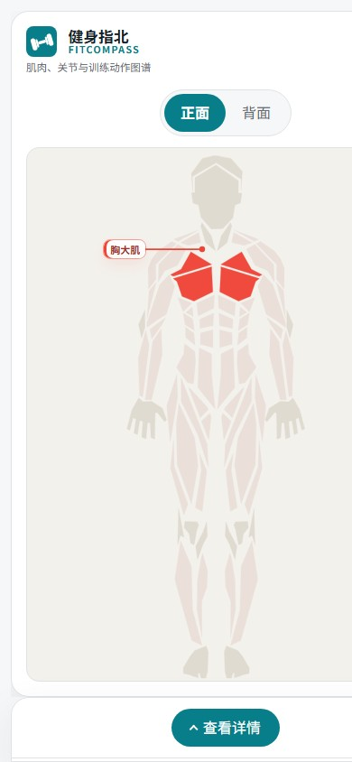

# 健身指北 · FitCompass

> 把肌肉、关节和训练动作连成一张可以点的地图。

[**在线体验 →**](https://bugdesigner-hy.github.io/fitcompass/) · [本地开发](#本地开发) · [数据与署名](#数据与署名)

[](https://github.com/BugDesigner-Hy/fitcompass/actions/workflows/deploy.yml)




## 这是什么

**健身指北（FitCompass）** 是一个面向健身初学者和学习者的交互式人体运动解剖图谱。

点击人体正面的胸大肌，你会看到它的起止点、功能、相关关节动作和训练动作；点击「杠铃卧推」，身体图会换一种方式告诉你：谁是主动肌、谁是协同肌、谁是稳定肌。反过来，从一块肌肉出发，也能顺着关系找到动作和训练。

它不是训练计划生成器，也不是医疗诊断工具。它想解决的是一个更基础的问题：**做这个动作时，身体里到底发生了什么？**

## 功能

- **可点击的人体肌肉图**：正面 / 背面切换，鼠标点击或键盘选择肌肉，选中结构与右侧详情同步。
- **肌肉 ↔ 关节动作 ↔ 训练动作**：从肌肉看功能，从关节动作看参与肌群，从训练动作看目标肌肉。
- **动作角色标记**：主动肌、协同肌、稳定肌、拮抗肌分别标注，避免只记动作名字。
- **动作详情卡**：器械、难度、目标肌肉、分步动作说明和演示媒体。
- **可分享的状态**：视图、选中结构和详情都写入 URL，刷新、前进、后退都能恢复。
- **移动端适配**：窄屏下详情变为可展开的底部抽屉，保持人体图可操作。
- **可访问性**：语义化区域、键盘操作、焦点样式和 `prefers-reduced-motion` 支持。
- **纯静态**：不需要后端，构建产物可以直接托管在 GitHub Pages。

## 动作详情

从动作反查目标肌肉，并查看每一步怎么做：



## 移动端

窄屏下保留完整人体图，详情收进底部抽屉，点开后再展开完整内容：

<p align="center">
  
</p>

## 本地开发

需要 Node.js 20+（推荐 22 LTS）。

```bash
npm install
npm run dev
```

打开终端提示的本地地址（默认 `http://localhost:5173/`）。

常用命令：

| 命令                   | 作用                             |
| ---------------------- | -------------------------------- |
| `npm run dev`          | 启动开发服务器                   |
| `npm run build`        | 类型检查并构建生产版本到 `dist/` |
| `npm run preview`      | 本地预览构建产物                 |
| `npm run typecheck`    | 只做 TypeScript 类型检查         |
| `npm test`             | 运行 Vitest 测试                 |
| `npm run lint`         | 运行 ESLint                      |
| `npm run format:check` | 检查 Prettier 格式               |

## 部署到 GitHub Pages

项目已经配置好 [`.github/workflows/deploy.yml`](.github/workflows/deploy.yml)：

1. 推送到 `main` 分支，或手动触发 **Deploy to GitHub Pages** workflow。
2. 仓库 **Settings → Pages → Source** 选择 **GitHub Actions**。
3. 构建完成后访问 <https://bugdesigner-hy.github.io/fitcompass/>。

Vite 的生产基路径是 `/fitcompass/`，路由 basename 会自动读取 `BASE_URL`；`public/404.html` 负责把直接访问的子路径带回单页应用。若把仓库改成其他名字，需要同步修改：

- `vite.config.ts` 中的 `base`
- `index.html`、`public/404.html` 中的 `/fitcompass/` 路径

## 技术栈

- React 19 + TypeScript
- Vite 7
- React Router 7
- Vitest + Testing Library
- 纯 CSS 设计系统与响应式布局（`src/styles/tokens.css`）

## 项目结构

```text
src/
├─ app/                 # 路由、应用壳和错误页
├─ features/
│  ├─ body-map/         # 平面肌肉图、轮廓映射、选中与标注
│  ├─ details/          # 肌肉、骨骼、关节动作和训练动作详情
│  └─ explorer/         # URL 状态与探索器状态
├─ data/                # 肌肉、骨骼、关节、动作与媒体数据
├─ domain/              # 领域模型、关系查询和数据校验
└─ styles/              # 设计令牌与全局样式
public/
├─ models/              # 三维模型文件
├─ 404.html             # GitHub Pages 单页应用回退
└─ favicon.svg
```

## 数据与署名

这个项目站在很多开放数据和开源项目之上：

- 肌肉 / 骨骼模型：Z-Anatomy（CC BY-SA 4.0）、BodyParts3D（CC BY 4.0）
- 平面肌肉轮廓：[Body Muscles](https://github.com/vulovix/body-muscles)（Apache-2.0，© Ivan Vulović）
- 动作静图：[RepDB](https://repdb.co) 免费档，页面保留 `Exercise data by RepDB (repdb.co)` 署名
- 动作动图：来自 [exercises-dataset](https://github.com/hasaneyldrm/exercises-dataset)，仅以远程地址加载，未收入本仓库

完整来源、许可和再分发限制见 [`public/assets/ATTRIBUTIONS.md`](public/assets/ATTRIBUTIONS.md)。

> 页面中带有「草稿 · 待专业审核」标记的解剖与训练内容仍在人工复核中，不构成医疗建议或个性化训练处方。第三方媒体在再分发前请自行核对上游许可。

## 许可

本项目**代码**采用 [MIT License](LICENSE)。`public/models/`、`src/data/` 中的第三方解剖数据与媒体、以及页面中远程加载的动作素材，仍分别遵循其原始许可；MIT 不覆盖这些第三方内容。
